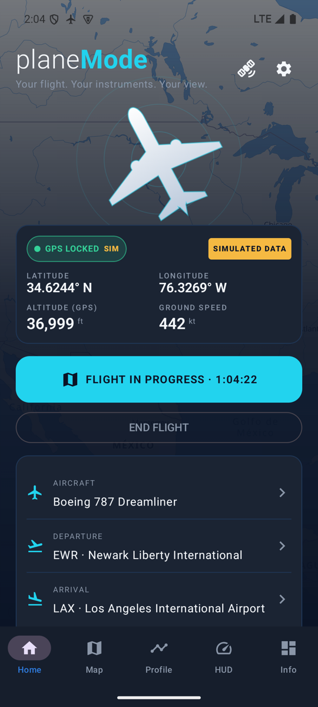
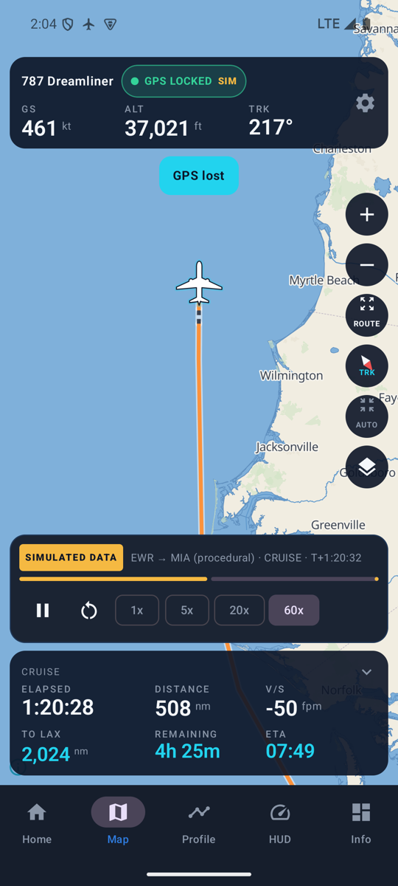
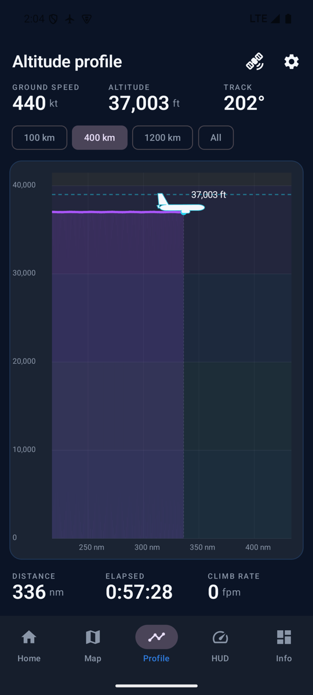
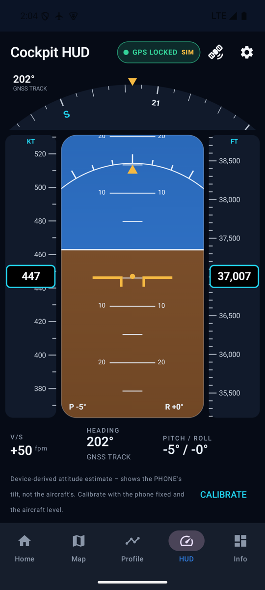
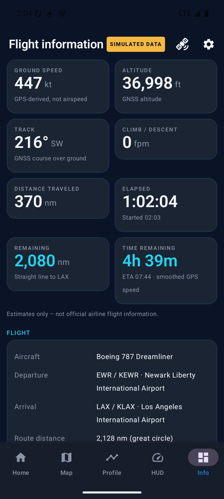

# planeMode

*Your flight. Your instruments. Your view.*

Native Android (Kotlin, Jetpack Compose, MVVM + Hilt) in-flight tracker that uses the phone's own GNSS receiver and sensors. Not an ADS-B or airline-data app.

## Screenshots
<p align="center">
  
  
  
  
  
</p>
<p align="center"><sub>Home · Map · Altitude profile · Cockpit HUD · Flight info (simulated cruise, captured on a Pixel emulator)</sub></p>

## Download & install (sideload)
1. On your Android phone (Android 8.0 or later), download **`planeMode-v1.0.0.apk`** from the [latest release](https://github.com/acbrandao/planemode/releases/latest).
2. Open the downloaded file. If Android blocks it, allow **Install unknown apps** for your browser or file manager when prompted (Settings → Apps → *your browser* → Install unknown apps).
3. Tap **Install**, then open planeMode and allow location access.

Or install from a computer with USB debugging enabled:
```bash
adb install planeMode-v1.0.0.apk
```

No account, API key or network connection is needed. To try it on the ground, turn on Settings → **Simulation** → **Enable mock flight** (see [Try it without flying](#try-it-without-flying-simulation)).

> The APK is signed with the project's release key. If you previously installed a debug build you built yourself, uninstall it first, because Android won't update an app signed with a different key.

## Requirements
- Android Studio (recent), JDK 17+ (builds were verified with JDK 25)
- Android SDK platform 37 (Gradle installs it automatically if the SDK licences are accepted)
- Device or emulator running Android 8.0 (API 26) or later

## Build & run
```bash
./gradlew :app:assembleDebug          # APK: app/build/outputs/apk/debug/app-debug.apk
./gradlew :app:installDebug           # install on a connected device/emulator
./gradlew :app:testDebugUnitTest      # unit tests
```
Or open the folder in Android Studio and run the `app` configuration.

### Signed release build
`./gradlew :app:assembleRelease` signs the APK when these properties are set in `~/.gradle/gradle.properties` (keep them out of the repo):
```properties
PLANEMODE_STORE_FILE=/path/to/planemode-release.jks
PLANEMODE_STORE_PASSWORD=...
PLANEMODE_KEY_ALIAS=planemode
PLANEMODE_KEY_PASSWORD=...
```
Without them, the release APK is built unsigned. Output: `app/build/outputs/apk/release/app-release.apk`.

## Try it without flying (simulation)
Settings → **Simulation** tab → **Enable mock flight**. Then press **START FLIGHT** on Home.
- Routes: procedural EWR → MIA generator (~2¾ h of flight, ~3 min at 60x), or the bundled recording `app/src/main/assets/mock_flight_ewr_mia.jsonl`
- **End flight** on a simulated flight stops playback and rewinds the simulator to the gate
- Controls (Home, Map, Settings): start / pause / reset, 1x / 5x / 20x / 60x, drop GPS 30 s, recover, weak signal, inaccurate fixes, missing satellite data
- A scripted 60 s GPS outage occurs during cruise (it can be turned off)
- Simulated data is marked **SIM** everywhere. No API keys or network are needed.

To regenerate the JSONL from the Kotlin generator:
`EXPORT_MOCK_JSONL=1 ./gradlew :app:testDebugUnitTest --tests '*FlightSimulationTest*'`

## Maps
The maps are vector only (MapLibre, OpenGL ES renderer). No raster tiles are used.
- **Embedded base map:** Natural Earth land, lakes, rivers and borders (public domain). Works fully offline.
- **Online detail:** a configurable OpenMapTiles-schema source. The default is [OpenFreeMap](https://openfreemap.org) (no key needed; attribution is shown on the map). To use your own provider, choose Settings → Mapping → Vector tile source → *Custom* and enter a TileJSON URL, a glyphs URL and an offline style URL (put any API key inside the URLs). Choose *Embedded only* to make no network requests.
- **Offline regions:** Settings → Mapping → Downloaded regions. Automatic downloads cover the area around the first GPS fix and a corridor along the planned route. You can also download any area manually. Downloads are Wi-Fi only by default, and a cache limit applies.

## Data sources
- Airports: [OurAirports](https://ourairports.com/data/) (public domain), filtered by `tools/prepare_data.py`
- Aircraft: `app/src/main/assets/aircraft.json`. These are approximate family-level reference values. You can set an online JSON source with the same schema in Settings → Aircraft.
- Sounds: original chimes synthesized by `tools/make_sounds.py`

## Notes
- Ground speed comes from GPS (it is not airspeed). Heading is the GNSS course over ground. HUD pitch and roll are estimates from the phone's sensors. The takeoff alert is an approximate speed threshold, not V1. The ETA is a straight-line estimate.
- Tracking runs in a location-type foreground service, so it continues with the screen off. Background-location permission is not requested.
